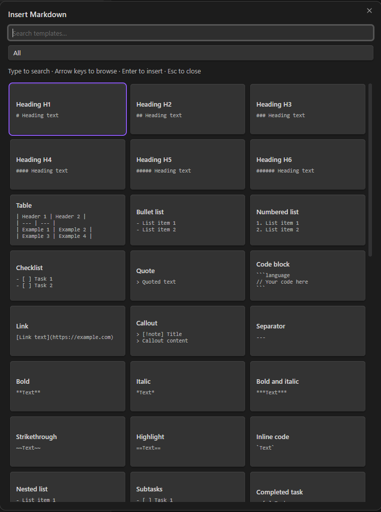
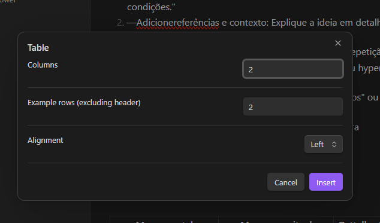
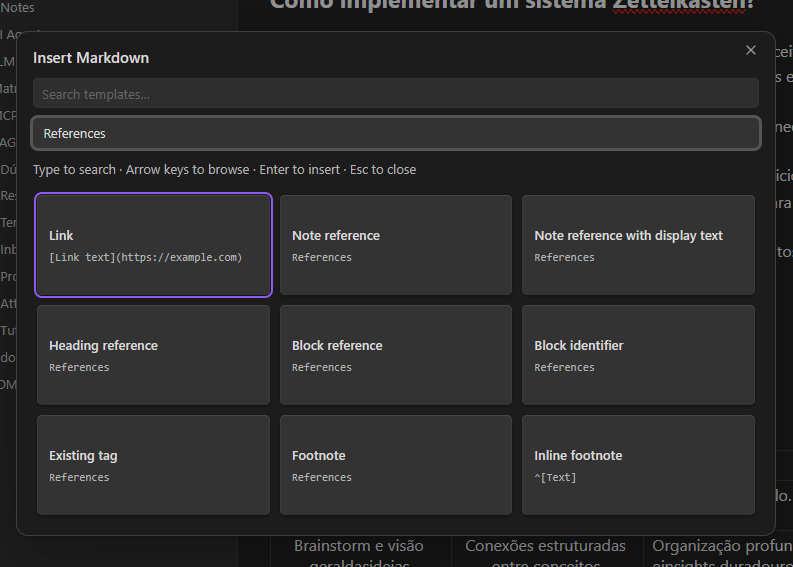
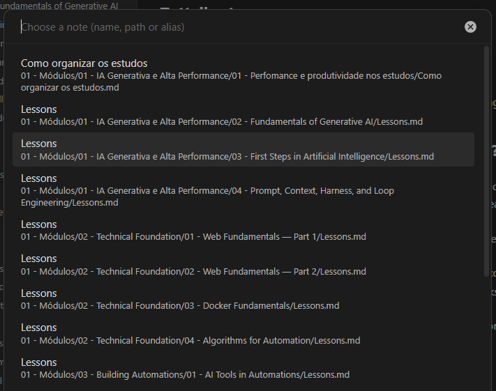

# Markdown Quick Insert

Insert Markdown formatting, tables, links, and embeds through a searchable grid inside Obsidian. Format selected text or insert editable examples without remembering Markdown syntax.

Version **0.2.6**, with **52 entries**, English/Brazilian Portuguese translations, vault-aware selectors, and contextual selection formatting.

## Screenshots

### Searchable insertion grid

Browse Markdown templates with previews, search, and category filters.



### Table options

Choose the number of columns, example rows, and column alignment before inserting a table.



### References

Find links, note references, heading and block references, tags, and footnotes in one category.



### Note selector

Choose an existing note by name, path, or alias. Full paths help distinguish notes with the same name.



## Requirements and compatibility

- Obsidian 1.8.0 or newer, as declared in the manifest. The minimum version still needs real-host verification before submission.
- An open Markdown note in Source mode or Live Preview. Reading view selections are not supported.
- The manifest permits desktop and mobile loading. Mobile behavior has not been verified; the keyboard workflow requires a keyboard.

## Installation and upgrade

### Community directory

Publication in the Obsidian Community directory has not yet been confirmed. Once the plugin is listed, open Settings → Community plugins → Browse, search for **Markdown Quick Insert**, then select Install and Enable.

### Manual installation from a release

1. Download `main.js`, `manifest.json`, and `styles.css` from a published GitHub release of this repository. Use files from the same release, not GitHub's automatically generated source archives.
2. Create `<vault>/.obsidian/plugins/markdown-quick-insert/` if it does not exist.
3. Copy the three files into that folder.
4. Reload Obsidian, then enable **Markdown Quick Insert** in Settings → Community plugins.

To upgrade, disable the plugin, replace those three files, and enable it again. Preserve any existing `data.json`, which stores the language preference. If no release is available, build from source below.

### Build from source

Run `npm ci` and `npm run build`. Manually copy `main.js`, `manifest.json`, and `styles.css` into `<vault>/.obsidian/plugins/markdown-quick-insert/`, then enable or reload the plugin. Keep existing `data.json` to preserve language settings.

The project does not install itself, create notes, alter reference targets, or change vault configuration. Only an explicit insertion changes the active editor. Discovery uses the public Obsidian API; the plugin makes no network requests.

## Use

Open a Markdown note in editing mode. Press **Ctrl+.**, or run **Markdown Quick Insert: Open Markdown quick insert**. Reassign the shortcut in Settings → Hotkeys. Control is the default on every platform; macOS users may assign Command.

Search or select a category: Text, Structures, References, Embeds, or Advanced. Use arrows to browse cards, Enter to choose, Tab to focus controls, and Escape to cancel. Follow-up selectors use Obsidian's standard searchable suggestions. Cancellation leaves the editor unchanged.

## Format selected text

Select text before pressing Ctrl+. to open **Format selected text**. This mode shows only compatible transformations, with Markdown previews using the actual selection. It hides insertion-only entries such as sample tables, embeds, separators, and existing tags. With no selection, the full insertion catalog remains available.

Selection endpoints are captured before keyboard shortcut dispatch, then verified against the source editor and document. A recent selection can be recovered if dispatch collapses it. Reversed selections are normalized. Cached ranges expire after 500 ms, are consumed once, and are cleared on pointer interaction. Select text in the Markdown editor (Source or Live Preview); selecting rendered text in Reading view is not supported.

Supported transformations include headings, quotes/nested quotes, bullet/numbered lists, checklists/completed tasks, callouts, fenced code, inline formatting, links, comments, math, and escaping. Available choices depend on the selected text: unsafe multiline inline formats and comments containing closing delimiters are omitted. Blank lines are preserved; list numbering counts nonempty lines. Existing heading markers are replaced when changing heading level.

Code and callout options still open their follow-up selectors while preserving the captured text. Code fences grow when needed to contain existing backticks. Selected text containing placeholder-like syntax is preserved literally. External links use the selection as their label and select the URL for editing. Note references with display text use the selection as the initial alias. Cancelling any step leaves the selection unchanged. Formatting is one editor replacement; real-host undo/redo remains a manual validation item.

## Automatic references

| Entry | Workflow |
| --- | --- |
| Note reference | Search existing Markdown notes by name, full path, or frontmatter alias. |
| Reference with display text | Choose a note, then edit display text. Selected editor text is the initial value. |
| Heading reference | Choose a note, then one of its cached headings. |
| Block reference | Choose a note, then one of its existing cached block IDs. |
| Embed note, heading, or block | Choose the target in the same way; insert an embed. |
| Existing tag | Search deduplicated inline and frontmatter tags from notes. |
| Block identifier | Insert an example paragraph with an identifier unused in the current document. |
| Footnote | Insert an unused reference and append its definition in one editor transaction. |

Paths distinguish duplicate names. Generated links honor Obsidian's link-format and path preferences, including Markdown links instead of wikilinks. Selecting an alias preserves it as display text. Generated links are inserted literally even when names contain placeholder-like text.

Headings, block IDs, aliases, and tags depend on Obsidian's metadata cache. Empty selectors show a localized message and insert nothing. Blocks must already have IDs: target notes are never modified. Deleted/renamed targets and removed headings/blocks are rejected at confirmation. Changes to source text or active editor also cancel insertion.

## Attachments and options

- Image, audio, video, PDF, and Canvas entries list matching existing vault files.
- Images accept an optional positive pixel width; PDFs accept an optional positive page number. Page count is not inspected.
- Tables accept 1–12 columns, 1–50 example rows, and left/center/right alignment.
- Callouts offer all 13 native types, with fixed-expanded or foldable-expanded/collapsed behavior.
- Code blocks offer common language identifiers and select the example code. The inserted identifier remains editable.

## Formatting catalog

Includes H1–H6, tables, bullet/numbered lists, checklist, completed task, nested lists/subtasks, quote/nested quote, fenced and inline code, external links/images, separator, bold, italic, bold+italic, strikethrough, highlight, comments, footnotes, inline/block math, Mermaid flowchart/sequence, collapsible HTML, hard line break, and escaped Markdown, alongside the dynamic entries above.

Without a selection, entries insert editable examples and select the first placeholder; concrete vault targets place the cursor after insertion. Footnotes select their definition text. Block templates add blank lines as needed; inline templates preserve sentence layout. With a selection, the contextual mode above preserves and formats its content.

This is a broad catalog, not every possible native construct or combination. YAML property editing, embedded search queries, every Mermaid diagram family, arbitrary HTML, custom CSS callouts, and community-plugin syntax are outside this release.

## Language

Automatic uses the public Obsidian language API. Only `pt-BR` selects Brazilian Portuguese; every other language falls back to English. Override this in Settings → Markdown Quick Insert. Reopen the grid after changing language. Reload the plugin to refresh the registered command name.

## Privacy and data

Read the [Privacy Policy](https://reve-signum-studios.web.app/privacy.html?app=markdown-quick-insert) (Brazilian Portuguese).

- The plugin processes the active note and vault metadata locally to format text and offer file, heading, block, alias, and tag selectors.
- It stores the language preference through Obsidian's plugin data API in the vault configuration. Inserted content is saved in the notes themselves.
- The plugin makes no network requests and includes no analytics, advertising, or telemetry. No account or external service is required by the plugin.
- Vault or configuration synchronization is handled by the service you choose, not by this plugin.
- Opening external links or displaying remote images inserted into notes can cause Obsidian or the browser to contact those external services.

## Support and feedback

Report bugs and feature requests through this repository's GitHub Issues, if enabled. Include the plugin version, Obsidian version, operating system, reproduction steps, and expected versus actual behavior. Remove private note content, credentials, and personal file paths from reports and screenshots.

See [the changelog](docs/changelog.md) for release history. This is a community plugin and is not an official Obsidian product.

## Development and validation

Requires Node.js 22.12 or newer.

```sh
npm ci
npm test
npm run build
npm run dev
```

Translations: `src/i18n/`. Catalog/helpers: `src/templates.ts` and `src/automation.ts`. The build bundles the plugin with Obsidian external; test dependencies are not bundled.

Automated tests cover language resolution, templates, filtering, boundaries, selection wrapping, table limits, identifiers, and reference/media flows through a focused host adapter. They do not establish real Obsidian rendering, keyboard behavior, or undo history.

Manual checks in an authorized test vault:

1. Test Ctrl+., search/categories, arrows, Enter, Tab, Escape, and shortcut reassignment.
2. Test duplicate filenames and aliases under both wikilink and Markdown-link preferences.
3. Test headings/blocks, missing IDs, cancellation, and stale source/target handling.
4. Test attachments, image width, PDF page, table options, callout collapse, and code languages.
5. Test selection wrapping, placeholder selection, footnotes, and undo/redo.
6. Test automatic/manual languages, light/dark themes, and narrow screens.

Official references: [Internal links](https://obsidian.md/help/links), [Embeds](https://obsidian.md/help/embeds), [Callouts](https://obsidian.md/help/callouts), and [Vault API](https://docs.obsidian.md/Plugins/Vault).
